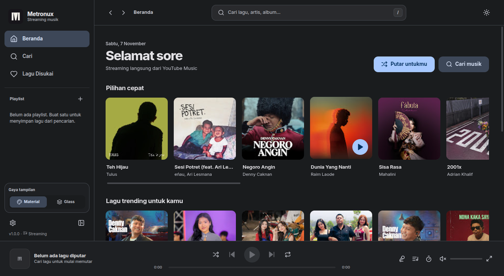
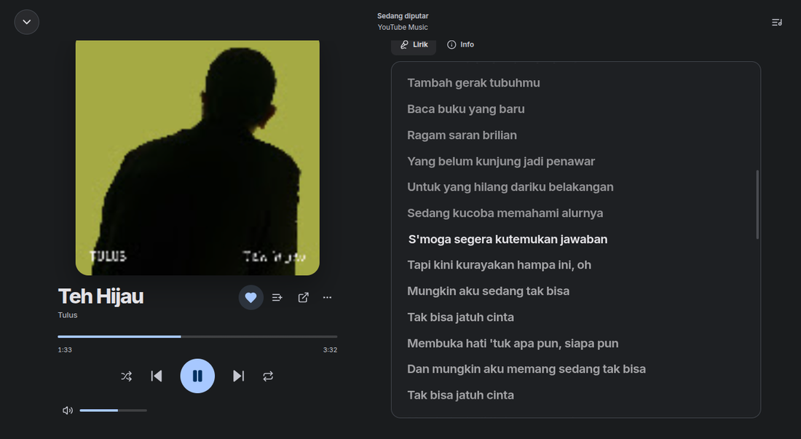
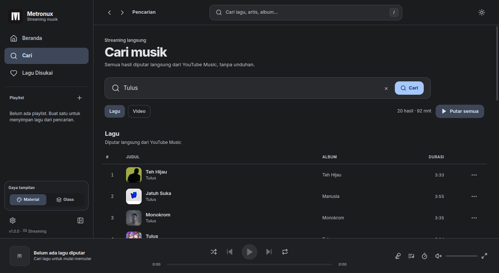
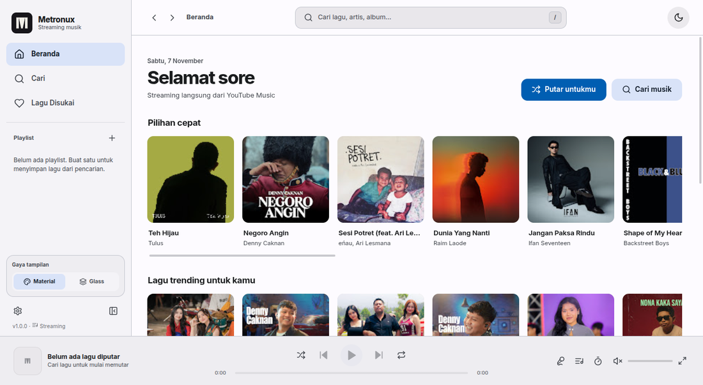
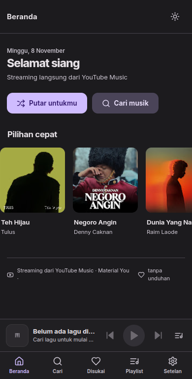
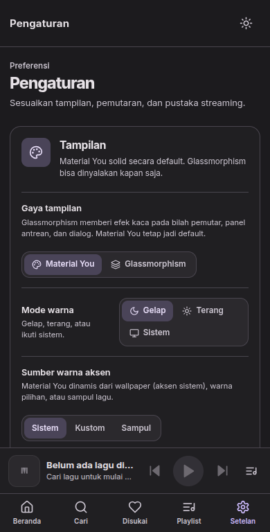

<p align="center">
  
</p>

<h1 align="center">Metronux</h1>

<p align="center">
  Pemutar musik streaming untuk Linux dengan tema Material You dan opsi Glassmorphism.
</p>

Metronux memutar lagu langsung dari YouTube Music tanpa mengunduh audio. Pencarian,
playlist, lagu disukai, dan riwayat bekerja dengan data streaming, jadi tidak ada impor
file lokal yang perlu diurus.

## Tampilan

| Beranda, tema gelap | Sekarang diputar |
| --- | --- |
|  |  |

| Pencarian lagu | Beranda, tema terang |
| --- | --- |
|  |  |

| Android, beranda | Android, pengaturan |
| --- | --- |
|  |  |

## Fitur

- **Streaming langsung.** Lagu dan video diputar dari YouTube Music melalui proxy lokal
  dengan dukungan HTTP Range, jadi seek, equalizer, dan kontrol media tetap bekerja.
- **Pencarian lagu dan video.** Hasil pencarian menampilkan durasi, album, dan sampul asli.
- **Beranda rekomendasi.** Feed diambil dari YouTube Music, dengan cadangan kurasi
  pencarian jika feed tidak tersedia.
- **Antrean pemutaran.** Putar berikutnya, tambahkan ke antrean, pindahkan dengan
  drag-and-drop, hapus, atau bersihkan antrean.
- **Playlist dan lagu disukai.** Buat, ubah nama, hapus, dan susun ulang playlist. Semua
  data menyimpan tautan lagu, bukan file audio.
- **Lirik tersinkron.** Diambil dari LRCLIB dan mengikuti posisi lagu saat diputar.
- **Equalizer lima band.** Preset siap pakai dan pengaturan manual.
- **Tema Material You.** Warna mengikuti aksen sistem, warna pilihan, atau sampul lagu.
  Tersedia mode gelap, terang, dan ikuti sistem.
- **Glassmorphism opsional.** Efek kaca dibatasi pada player bar dan panel antrean agar
  hierarki tampilan tetap jelas.
- **Kontrol media dan pintasan.** Media session, tombol media keyboard, serta pintasan
  untuk memutar, mencari, dan membuka antrean.

## Cara memakai

1. Buka **Cari** di sidebar, lalu ketik judul lagu, artis, atau album.
2. Pilih hasil untuk langsung memutar, atau buka menu `...` untuk menambah ke antrean
   atau playlist.
3. Tekan ikon hati untuk menyimpan lagu ke **Lagu Disukai**.
4. Buka **Beranda** untuk melihat rekomendasi dari feed YouTube Music.

## Teknologi

| Bagian | Teknologi |
| --- | --- |
| Shell desktop | Electron 45 |
| Antarmuka | React 19 dan Vite 8 |
| Sumber musik | youtubei.js |
| Palet Material You | material-color-utilities |
| Lirik | LRCLIB |
| Paket Linux | electron-builder (AppImage) |
| Android | WebView, nodejs-mobile, Gradle |

## Persyaratan

- Linux dengan X11 atau Wayland.
- Node.js 22 atau lebih baru dan npm.
- Koneksi internet untuk streaming.
- Pustaka runtime Electron untuk distro kamu, seperti GTK 3, NSS, dan ALSA atau PulseAudio.

## Menjalankan

```bash
git clone https://github.com/Zoltraak57/MetroNux.git
cd MetroNux
npm install
npm run dev
```

`npm run dev` menjalankan Vite dan Electron sekaligus dengan hot reload.

Untuk memakai hasil build produksi:

```bash
npm run build
npm start
```

Atau jalankan keduanya dalam satu perintah:

```bash
npm run app
```

## Build AppImage

```bash
npm run dist
```

Hasil build ada di `release/`. File AppImage dapat dijalankan langsung tanpa instalasi.
Jika distro kamu tidak menyediakan FUSE 2, jalankan dengan `APPIMAGE_EXTRACT_AND_RUN=1`.

## Android (APK)

Versi Android memakai runtime Node.js tertanam dan WebView untuk menjalankan
antarmuka React yang sama. Satu APK universal mendukung perangkat 32 bit
(`armeabi-v7a`) dan 64 bit (`arm64-v8a`).

Fitur yang tersedia sama dengan versi desktop: pencarian, beranda, playlist,
lagu disukai, antrean, lirik, equalizer, dan tema Material You.

### Memasang

1. Unduh `Metronux-1.0.0-universal.apk` dari halaman Releases.
   Jika kamu membangun sendiri, hasilnya ada di `release/android/`.
2. Izinkan pemasangan dari sumber tidak dikenal jika sistem meminta.
3. Buka Metronux dan pastikan perangkat terhubung ke internet.

### Build APK

Prasyarat:

- JDK 17.
- Android SDK dengan `platforms;android-35`, `build-tools;35.0.0`, dan
  `ndk;26.1.10909125`.
- Gradle 8.11 (tersedia lewat `android/gradlew`).

```bash
export ANDROID_HOME=/path/ke/android-sdk
export JAVA_HOME=/path/ke/jdk-17
npm run android:apk
```

Perintah itu mengunduh library nodejs-mobile, membangun UI mobile, menyalin
aset, lalu menghasilkan `release/android/Metronux-1.0.0-universal.apk`.
Jika `android/keystore.properties` belum ada, skrip membuat keystore rilis
baru secara otomatis. Simpan keystore itu; APK dengan kunci berbeda tidak
dapat memperbarui instalasi sebelumnya. Jangan membagikan berkas keystore
dan `android/keystore.properties` ke publik.

### Catatan Android

- Data aplikasi disimpan di penyimpanan internal aplikasi, bukan di
  `~/.config/Metronux`.
- Tombol media, headset, dan Bluetooth ditangani lewat MediaSession Android.
- Pemutaran di latar belakang mengikuti kebijakan penghemat baterai perangkat.
  Beberapa vendor mematikan aplikasi saat layar mati; izinkan Metronux berjalan
  di latar belakang jika pemutaran terhenti.
- APK memakai cleartext hanya untuk `127.0.0.1`, tempat backend lokal berjalan.
  Koneksi ke YouTube Music dan LRCLIB tetap memakai HTTPS.

## Data aplikasi

Pengaturan, playlist, lagu disukai, dan riwayat disimpan di direktori `userData` Electron.
Lokasi umumnya:

```text
~/.config/Metronux/
├── metronux.json   # pengaturan, playlist, favorit, riwayat
└── artcache/       # cache sampul
```

Saat pertama kali dijalankan, Metronux menyalin data dari `~/.config/Mentronux` jika folder
baru belum ada. Hanya pengaturan yang dipertahankan. Playlist, favorit, dan riwayat lama
yang memakai ID file lokal dibuang karena tidak berlaku untuk streaming.

Untuk pengembangan, lokasi data bisa diarahkan ke folder lain:

```bash
METRONUX_DATA_DIR=/path/ke/data npm start
```

## Pintasan keyboard

| Tombol | Aksi |
| --- | --- |
| `Space` | Putar atau jeda |
| `←` / `→` | Mundur atau maju 5 detik |
| `Ctrl+←` / `Ctrl+→` | Lagu sebelumnya atau berikutnya |
| `M` | Bisukan suara |
| `S` | Acak |
| `R` | Ulangi: mati, semua, satu |
| `Q` | Buka antrean |
| `L` | Buka tampilan sekarang diputar |
| `/` | Cari |
| `Esc` | Tutup tampilan sekarang diputar atau antrean |

Pintasan diabaikan saat fokus berada di kolom input.

## Struktur proyek

```text
electron/
├── main.js         # proses utama, IPC, media keys, jendela
├── preload.js      # jembatan API ke renderer
├── store.js        # penyimpanan JSON atomik
├── server.js       # proxy stream YouTube dan penyajian sampul
├── ytmusic.js      # pencarian, feed beranda, resolusi stream
├── lyrics.js       # pencarian LRCLIB dan parser LRC
└── utils.js        # aksen sistem dan utilitas
src/
├── context/        # Settings, Route, Library, Player, UI, Toast
├── components/     # shell, player, dialog, daftar lagu
├── pages/          # beranda, pencarian, playlist, favorit, pengaturan
├── lib/            # tema Material, API, format, equalizer
└── styles.css      # Material You dan override Glassmorphism
scripts/
├── dev.js          # Vite dan Electron untuk pengembangan
├── test-backend.js # uji store, parser lirik, dan proxy stream
├── build-mobile.js # build UI dan aset Android
├── setup-android.js # unduh library nodejs-mobile
└── build-android.js # jalankan Gradle dan salin APK
mobile/
├── shim.js         # jembatan API untuk WebView Android
└── backend/        # server HTTP lokal di Android
android/            # proyek Gradle, JNI, dan konfigurasi APK
```

## Pengujian

```bash
npm run test:backend
```

Uji ini berjalan tanpa Electron dan mencakup normalisasi track streaming, migrasi data
lama, penyimpanan playlist, favorit, dan riwayat, parser lirik, serta server sampul dan
proxy stream dengan token dan HTTP Range.

## Catatan

- Token server media dibuat acak setiap aplikasi dijalankan. Server hanya mendengarkan di
  `127.0.0.1`.
- URL audio diambil ulang otomatis saat kedaluwarsa atau ditolak YouTube. Streaming tetap
  memerlukan koneksi internet.
- Ketersediaan lagu mengikuti katalog YouTube Music dan dapat berubah sewaktu-waktu.
  Gunakan fitur ini untuk konten yang kamu berhak akses.
- Aksen sistem dibaca dari pengaturan GNOME atau KDE jika tersedia. Jika tidak, Metronux
  memakai ungu Material `#6750A4`.
- Hook pengembangan `METRONUX_ROUTE`, `METRONUX_SCREENSHOT`, `METRONUX_SCREENSHOT_DELAY`,
  dan `METRONUX_EXIT_AFTER_SCREENSHOT` tersedia untuk pengujian UI otomatis. Nama lama
  `MENTRONUX_*` tetap diterima.

## Lisensi

MIT. Lihat berkas [`LICENSE`](LICENSE) untuk teks lengkap.
